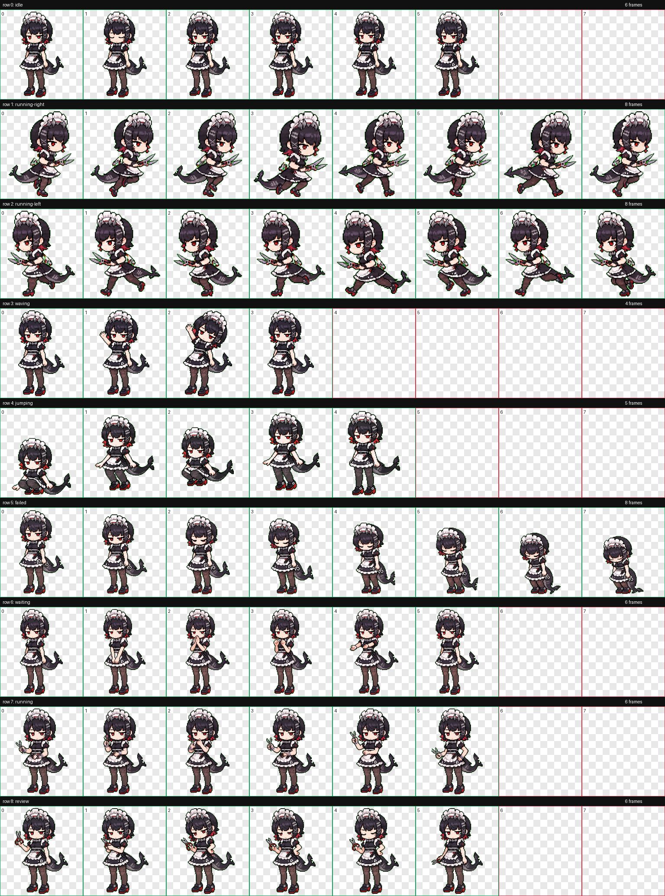

[English](README.md) | [简体中文](README.zh-CN.md)

# Ellen Joe Pixel — Codex 宠物

> **项目状态：** 公开的非官方同人作品。最新版本：
> [v0.1.2](https://github.com/atanllama/ellen-joe-codex-pet/releases/tag/v0.1.2)。

Ellen Joe Pixel 是一个面向 Codex 的全身 Ellen Joe 宠物包，包含 Codex v2
精灵图、跨平台安装脚本和本地包校验器。本项目为非官方、非商业同人作品，
与 HoYoverse、Cognosphere 或 OpenAI 没有隶属、赞助或认可关系。

请先阅读 [v0.1.3 候选说明](docs/releases/v0.1.3.md)、[权利、许可证与来源](#权利许可证与来源)
以及本页对应的 [English guide](README.md)。

## 包信息

| 字段 | 内容 |
| --- | --- |
| 显示名称 | Ellen Joe Pixel |
| 包 ID | ellen-joe-pixel |
| 精灵图协议 | Codex v2 |
| 图集 | WebP，1536 x 2288，8 列 x 11 行 |
| 单元格尺寸 | 192 x 208 |
| 注视方向循环 | 按屏幕坐标顺时针排列，共 16 个方向 |
| 安装目标 | CodexHome/pets/ellen-joe-pixel |

标准动画行包括 idle、移动、挥手、跳跃、失败、等待、running/work 和
review。注视方向从 000（上）经过 090（右）、180（下）到 270（左）。

## 支持平台与前置条件

| 平台 | 当前支持证据 | 要求 |
| --- | --- | --- |
| Windows | 本地 PS 5.1/7 隔离测试通过；候选 CI 未运行 | PowerShell 5.1 或 PowerShell 7 |
| macOS | 候选版本未运行 macOS CI | POSIX sh 和 Python 3 |
| Ubuntu | 候选版本未运行 Ubuntu CI | POSIX sh 和 Python 3 |
| 其他 Linux 发行版 | 本仓库不保证 | 请自行检查脚本并测试 |

POSIX 安装脚本会使用 Python 3 校验 manifest。仓库校验器还需要 Pillow；
运行校验器前请安装校验依赖：

~~~sh
python -m pip install -r requirements-validator.txt
~~~

CI 会校验包契约和安装脚本行为，但不会自动操作 Codex 桌面应用界面；
宠物是否出现在选择器中需要手动确认。

## 快速安装

请在仓库克隆目录或解压后的发布目录中运行以下命令。

### Windows

PowerShell 7：

~~~powershell
pwsh -NoProfile -File .\scripts\install.ps1
~~~

Windows PowerShell 5.1：

~~~powershell
powershell -NoProfile -File .\scripts\install.ps1
~~~

如需指定 Codex home，请把示例中的占位符替换为实际目录：

~~~powershell
pwsh -NoProfile -File .\scripts\install.ps1 -CodexHome '<CodexHome>'
~~~

Windows 安装器按以下顺序解析 home：

1. 已提供的 -CodexHome；
2. CODEX_HOME 环境变量；
3. %USERPROFILE%\.codex。

### macOS 或 Linux

~~~sh
sh ./scripts/install.sh
~~~

指定 home 的示例：

~~~sh
sh ./scripts/install.sh --codex-home "$HOME/.codex-test"
~~~

POSIX 安装器按以下顺序解析 home：

1. 已提供的 --codex-home；
2. CODEX_HOME 环境变量；
3. $HOME/.codex。

两个安装器都会在修改目标前校验源 manifest 和固定的 WebP 文件。普通安装
返回退出码 0；如果精确目标已存在，安装器返回退出码 2，并保持原安装不变。

## 覆盖已有安装

只有在确认现有目标确实是要替换的包后，才使用强制选项：

~~~powershell
pwsh -NoProfile -File .\scripts\install.ps1 -CodexHome '<CodexHome>' -Force
~~~

~~~sh
sh ./scripts/install.sh --codex-home "$HOME/.codex-test" --force
~~~

安装器会先暂存新包，再把旧的精确目标移动到
CodexHome/pet-backups 下的唯一备份目录，最后安装暂存目标，并输出备份路径。
备份目录位于 pets 发现目录之外，因此不会被 Codex 误识别为第二个宠物。
卸载不会删除备份或其他相邻宠物。[v0.1.1](https://github.com/atanllama/ellen-joe-codex-pet/blob/main/docs/releases/v0.1.1.md)
修复了强制重装导致重复条目的备份位置问题。

## 校验包

在解压目录安装校验依赖后运行：

~~~sh
python scripts/validate_pet.py pet/ellen-joe-pixel
~~~

Windows 等价命令：

~~~powershell
python .\scripts\validate_pet.py .\pet\ellen-joe-pixel
~~~

校验成功返回 0，包契约失败返回 1。批准 WebP 图集的 SHA-256 统一记录于：

~~~text
release-assets.json -> spritesheetSha256
~~~

Windows：

~~~powershell
(Get-FileHash -Algorithm SHA256 .\pet\ellen-joe-pixel\spritesheet.webp).Hash
~~~

Linux：

~~~sh
sha256sum pet/ellen-joe-pixel/spritesheet.webp
~~~

macOS：

~~~sh
shasum -a 256 pet/ellen-joe-pixel/spritesheet.webp
~~~

也可以校验已安装目录；如果使用了自定义 home，请替换下面的路径：

~~~sh
python scripts/validate_pet.py "$HOME/.codex/pets/ellen-joe-pixel"
~~~

## 在 Codex 中选择宠物

打开 Codex Pet 选择器，选择 Ellen Joe Pixel，并确认包 ID 为
ellen-joe-pixel。如果安装时选择器已经打开，请关闭后重新打开，使其重新
加载宠物列表。

## 卸载

Windows：

~~~powershell
pwsh -NoProfile -File .\scripts\uninstall.ps1
~~~

macOS 或 Linux：

~~~sh
sh ./scripts/uninstall.sh
~~~

如果安装时使用了自定义 home，请分别传入
-CodexHome '<CodexHome>' 或 --codex-home "$HOME/.codex-test"。
卸载只删除 CodexHome/pets/ellen-joe-pixel，不会删除
CodexHome/pet-backups、pets/sentinel 或其他相邻宠物。精确目标不存在时，
返回退出码 2。

## 处理残留安装锁

安装器和卸载器使用精确路径
CodexHome/pets/.ellen-joe-pixel.install.lock 协调并发操作。首先确认没有
安装或卸载进程正在运行；操作进行中绝对不要删除锁。

Windows 中锁是文件：

~~~powershell
$codexHome = Join-Path $env:USERPROFILE '.codex'
$lock = Join-Path $codexHome 'pets\.ellen-joe-pixel.install.lock'
Remove-Item -LiteralPath $lock -Force
~~~

macOS 或 Linux 中锁是空目录：

~~~sh
codex_home="${CODEX_HOME:-$HOME/.codex}"
rmdir "$codex_home/pets/.ellen-joe-pixel.install.lock"
~~~

如果使用了 CODEX_HOME 或自定义 home，请把示例 home 替换为实际值。

## 退出码

| 代码 | 含义 | 建议 |
| ---: | --- | --- |
| 0 | 操作成功。 | 如有需要，查看输出的目标或备份路径。 |
| 2 | 未使用强制选项但安装目标已存在，或卸载 home/目标不存在。 | 检查目标；只有明确需要时才强制覆盖，卸载目标不存在可视为已移除。 |
| 3 | 源文件、参数、manifest、home 无效，或路径存在不安全链接/重解析点。 | 修正输入；不要改用更宽泛的路径重试。 |
| 4 | 可恢复的操作失败；强制安装在适用时已恢复旧目标，或操作无法取得锁。 | 阅读错误信息，处理原因后再安全重试。 |
| 5 | 安装/回滚、卸载或清理发生不可恢复失败。 | 停止操作，保留输出的备份/暂存路径，只针对精确目标人工恢复。 |

脚本不会递归删除其他宠物或备份目录。

## 发布文件

请从最新的 [v0.1.2 Release](https://github.com/atanllama/ellen-joe-codex-pet/releases/tag/v0.1.2)
下载并在安装前校验 SHA256SUMS.txt：

- ellen-joe-pixel-v0.1.2.zip
- ellen-joe-pixel-v0.1.2.tar.gz
- SHA256SUMS.txt

解压后请再次运行包校验器。版本细节见
[v0.1.3 候选说明](docs/releases/v0.1.3.md)。

同时核对结构与批准字节：

~~~sh
python scripts/validate_pet.py pet/ellen-joe-pixel --asset-lock release-assets.json
~~~

lock 是批准素材的一致性记录，不是数字签名。v0.1.3 跨平台 CI 与真实应用验收尚未运行；历史 CI 不代表候选版本通过。

## 贡献与问题反馈

开发需要完整仓库，并安装 `pip install -r requirements-dev.txt`。播放 HTML 为维护者工具，参见候选说明。

欢迎为脚本、测试和文档提交贡献。提交 PR 前请运行：

~~~sh
python -m pytest -q
python scripts/validate_pet.py pet/ellen-joe-pixel
~~~

请不要提交第三方艺术、源材料、凭据或未经审核的生成资产。反馈问题时，
请提供操作系统、Shell/运行时版本、发布版本或 commit、完整命令、退出码
以及已脱敏的输出；发布前删除本机路径和密钥。

## 权利、许可证与来源

本项目是非官方、非商业同人作品，与 HoYoverse、Cognosphere 或 OpenAI
没有隶属、赞助或认可关系。角色和相关作品的权利归其各自权利人所有。

代码和文档仅在 [LICENSE](LICENSE) 规定的范围内采用 MIT 许可证。角色、
spritesheet、艺术图、QA 媒体和其他排除项不在代码/文档许可证范围内，
并由 [NOTICE.md](NOTICE.md) 约束。来源致谢和 provenance notice 统一见
[THIRD_PARTY_NOTICES.md](THIRD_PARTY_NOTICES.md)。

本项目仅将以下仓库作为设计与兼容性研究参考：

- [PlanningStudy with Ellen AI Pet](https://github.com/T-yi-feng/PlanningStudy-with-ellen-ai-pet-)
- [Frieren Codex Pet](https://github.com/zc-xu/frieren-codex-pet)

本项目未包含来自上述仓库的 ANI、PSD、sprites、像素、prompt、源代码或
动画帧。
